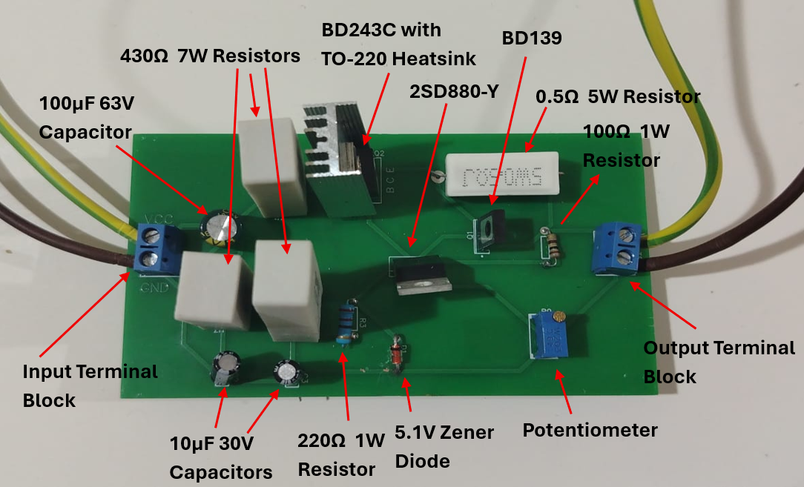
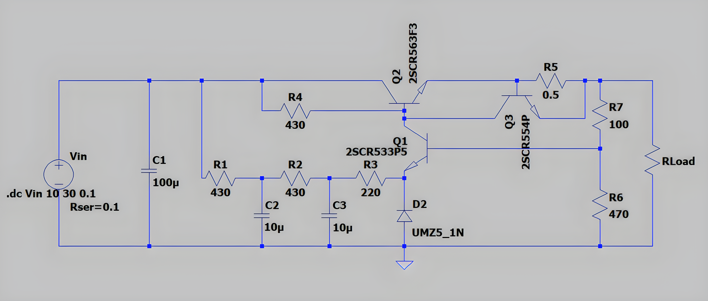
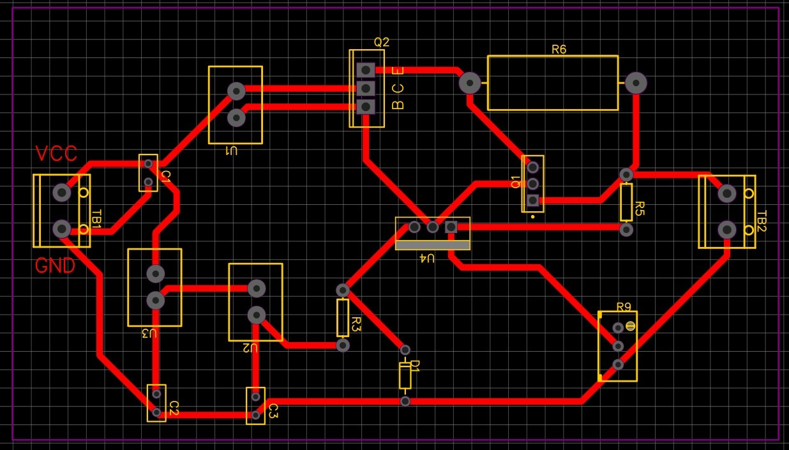
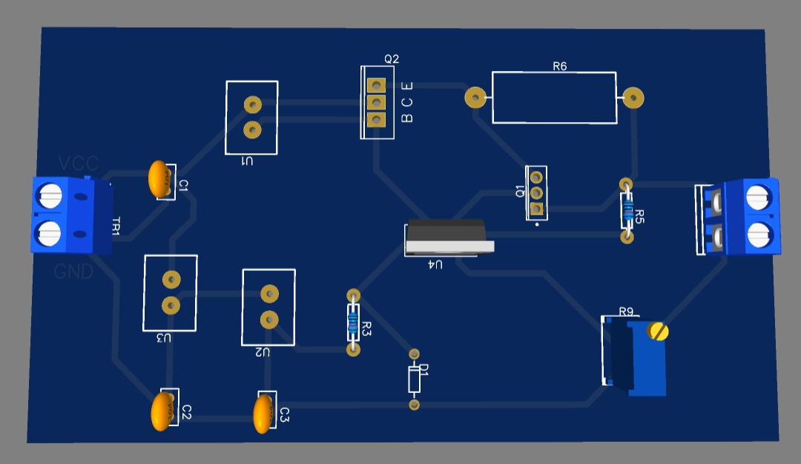
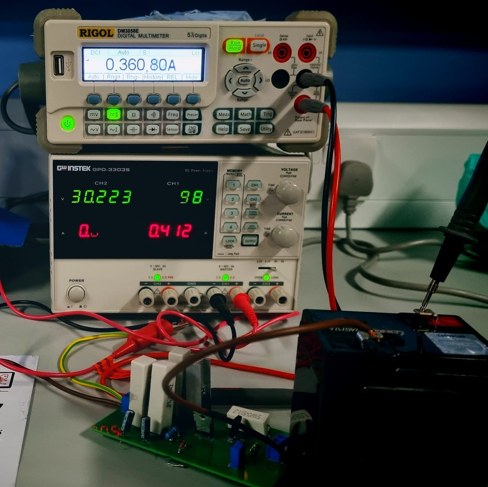

<h1 align="center">6 V Lead-Acid Battery Charger</h1>

<p align="center">
  A discrete series-pass voltage regulator with feedback and current limiting, taken from analysis to LTspice simulation to a custom PCB.
  <br/>Electronic Devices · Abu Dhabi University
</p>

<p align="center">
  
  
  
  
</p>

<p align="center">
  <a href="https://www.youtube.com/shorts/8GQJvr1EuwU"><b>Watch the demo</b></a>
</p>

<p align="center"></p>

## Overview

Lead-acid batteries degrade quickly when charged with an unstable voltage. This charger holds a steady **~7 V** output while the input swings anywhere from **10 V to 30 V**. It uses only discrete parts: a Zener reference, a transistor error amplifier, a power pass transistor, and a current-limiting transistor that protects against overloads and short circuits.

## Circuit

<p align="center"></p>

| Part | Role |
|---|---|
| **5.1 V Zener diode** | Stable voltage reference |
| **Error amplifier transistor** | Compares a fraction of the output (R6/R7 divider) with the reference |
| **Power pass transistor (BD243C on a heatsink)** | Regulates the voltage and current delivered to the battery |
| **Driver transistor** | Supplies enough base current to the pass transistor |
| **Current-limit transistor + 0.5 Ω sense resistor** | Cuts drive when load current rises too high |
| **100 µF / 10 µF capacitors** | Steady the input and stabilize the reference and feedback |
| **Potentiometer** | Fine-tunes the output voltage |

Transistors used in hardware: **BD243C**, **BD139** and **2SD880-Y**.

## Results

| Metric | Result |
|---|---|
| Output voltage | ~6.8–7.0 V across the full 10–30 V input sweep |
| Voltage regulation | **≈ 0.73%** |
| Output resistance (20 Ω test) | 20.06 Ω calculated (0.3% error) |
| Efficiency | 43–47.5% depending on load (typical for a linear regulator) |
| Battery test | Confirmed current flowing into a real 6 V lead-acid battery |

| Load | Efficiency |
|---|---|
| 5 Ω | 43.2% |
| 10 Ω | 47.5% |
| 15 Ω | 47.1% |
| 20 Ω | 46.0% |

The regulator performs best at moderate to high load resistance. At 5 Ω, the higher collector current and power-dissipation limits cause more output variation.

## From design to hardware

| PCB layout (EasyEDA) | 3D preview |
|:--:|:--:|
|  |  |

<p align="center"><br/><sub>Charging a 6 V lead-acid battery from a 30 V bench supply</sub></p>

## Project phases

1. **Phase 1, simulation:** designed the regulator in LTspice and ran DC sweeps (10–30 V) with no load and with 5, 10, 15 and 20 Ω loads. See the [Phase 1 report](docs/Phase1_Simulation_Report.pdf).
2. **Phase 2, hardware:** analytical design, PCB in EasyEDA, assembly, load and efficiency testing, and real battery charging. See the [final report](docs/Final_Report.pdf).

## Files

```
simulation/   LTspice schematics (.asc), phase 1 and final design
docs/         Phase 1 simulation report and final report
images/       Schematic, PCB layout, 3D render, built board, lab test
```

Open the `.asc` files in [LTspice](https://www.analog.com/en/resources/design-tools-and-calculators/ltspice-simulator.html) and run the `.dc Vin 10 30 0.1` sweep.

## Team

**Layth Oday** · **Waleed Abdullah Jallad** · **Amr Jalad**

---

<p align="center"><a href="https://github.com/loliamro">github.com/loliamro</a> · <a href="https://www.linkedin.com/in/amrjallad/">LinkedIn</a></p>
